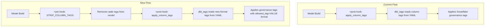
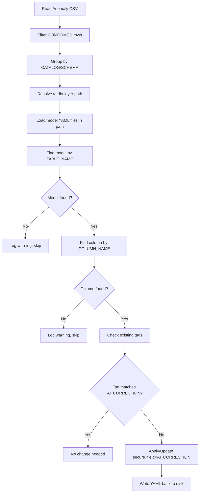

# Design Document: dbt Tags Migration

## Overview

This design covers the migration of PI (Personal Information) governance tagging from the legacy per-tag-type format to the new dbt-tags 1.9.0+ format using `secure_field=<VALUE>` convention. The migration touches configuration files (`dbt_project.yml`, `packages.yml`), model YAML files across all layers, and the shared macros file (`common_macros.sql`).

The migration is a coordinated set of file edits — not a runtime code change. The core transformation is:
- Legacy tag: `pi_full_name` or `PI_FULL_NAME` (standalone tag value)
- New tag: `secure_field=PI_FULL_NAME` (allowed_tag=UPPERCASE_VALUE)

### Scope Summary

| Area | Files Affected | Change Type |
|------|---------------|-------------|
| Package version | `packages.yml`, `package-lock.yml` | Verify/update dbt_tags ≥ 1.9.0 |
| Project vars | `dbt_project.yml` | Add 3 new `dbt_tags__` vars |
| Column-level tags | ~12 model YAML files across all layers | Convert `pi_*` → `secure_field=PI_*` and move to `config.tags` |
| Model-level tags | `dbt_project.yml` (2 `+tags` blocks) | Remove entirely |
| Legacy macros | `macros/common_macros.sql` | Remove ~17 masking policy macros |
| Pre-hook | `dbt_project.yml` | Add `+pre-hook` calling `STRIP_COLUMN_TAGS` |
| Legacy pre_sql | Model SQL/YAML files | Scan and remove tag-related `pre_sql` (none found currently) |

## Architecture

The migration does not change the runtime architecture of the dbt project. It modifies the declarative configuration layer that drives Snowflake governance tag application.



### Key Architectural Decisions

1. **Pre-hook at top model level**: The `+pre-hook` calling `STRIP_COLUMN_TAGS` is placed at the same level as the existing `+post-hook` under `models.pexa_one_data_au_group_dbt`. This ensures every model gets stale tags stripped before new tags are applied, without needing per-layer configuration.

2. **Model-level tags removed, not converted**: The `+tags` lists in `dbt_project.yml` (under `internal_data_services.salesforce` and `external_data_services.kapiche`) are removed entirely. Tag governance is managed exclusively at the column level in model YAML files. This avoids ambiguity about which tags apply where.

3. **Tag format convention**: `secure_field` (lowercase) + `=` separator + `PI_VALUE` (uppercase). The `variant_mask` allowed tag is configured but not currently used — it's available for future use.

4. **dbt_tags version via common lib**: The `dbt_tags` package is a transitive dependency through `pexa-one-data-au-dbt-common-lib`. If the common lib already resolves 1.9.0+, no direct dependency is needed. Otherwise, a direct dependency is added to `packages.yml`.

## Components and Interfaces

### Component 1: dbt_project.yml Configuration

**Changes:**

1. **New vars** (added to existing `vars` section):
```yaml
vars:
  # ... existing vars unchanged ...
  dbt_tags__opt_in_default_naming_config: false
  dbt_tags__allowed_tags: ["secure_field", "variant_mask"]
  dbt_tags__tag_name_separator: "="
```

2. **Pre-hook** (added alongside existing `+post-hook`):
```yaml
models:
  pexa_one_data_au_group_dbt:
    +persist_docs:
      relation: true
      columns: true
    +pre-hook:
      - >
        
          {{ dbt_tags.strip_column_tags() }}
        
    +post-hook:
      - >
        
          {{ dbt_tags.apply_column_tags() }}
        
```

> **Note**: The requirements reference `STRIP_COLUMN_TAGS` as a stored procedure. The actual invocation depends on whether dbt_tags 1.9.0 exposes this as a macro (`dbt_tags.strip_column_tags()`) or requires a direct SQL call (`CALL {{env_var('DBT_GOVERNANCE_DB')}}.{{env_var('DBT_GOVERNANCE_SCHEMA')}}.STRIP_COLUMN_TAGS(...)`). The implementation task should verify the correct invocation pattern from the dbt_tags 1.9.0 documentation.

3. **Remove model-level +tags** (2 blocks):
   - `internal_data_services.salesforce.+tags` — 14 tag entries
   - `external_data_services.kapiche.+tags` — 2 tag entries

### Component 2: Column-Level Tag Conversion

**Tag Mapping Table:**

| Legacy Tag | New Tag |
|-----------|---------|
| `pi_full_name` / `PI_FULL_NAME` | `secure_field=PI_FULL_NAME` |
| `pi_email` / `PI_EMAIL` | `secure_field=PI_EMAIL` |
| `pi_name` / `PI_NAME` | `secure_field=PI_NAME` |
| `pi_business_name` / `PI_BUSINESS_NAME` | `secure_field=PI_BUSINESS_NAME` |
| `pi_contact_number` / `PI_CONTACT_NUMBER` | `secure_field=PI_CONTACT_NUMBER` |
| `pi_free_text_field` / `PI_FREE_TEXT_FIELD` | `secure_field=PI_FREE_TEXT_FIELD` |
| `pi_full_address` / `PI_FULL_ADDRESS` | `secure_field=PI_FULL_ADDRESS` |
| `pi_partial_address` / `PI_PARTIAL_ADDRESS` | `secure_field=PI_PARTIAL_ADDRESS` |
| `pi_sensitive` / `PI_SENSITIVE` | `secure_field=PI_SENSITIVE` |
| `pi_sensitive_financial` / `PI_SENSITIVE_FINANCIAL` | `secure_field=PI_SENSITIVE_FINANCIAL` |
| `pi_userid` / `PI_USERID` | `secure_field=PI_USERID` |
| `pi_dob` / `PI_DOB` | `secure_field=PI_DOB` |
| `pi_fax` / `PI_FAX` | `secure_field=PI_FAX` |
| `pi_multi` / `PI_MULTI` | `secure_field=PI_MULTI` |
| `pi_flag_sensitive` / `PI_FLAG_SENSITIVE` | `secure_field=PI_FLAG_SENSITIVE` |

**Affected YAML Files (by layer):**

| Layer | File | Approx. Tag Count |
|-------|------|-------------------|
| raw | `models/raw/kapiche/raw_kapiche.yml` | 3 |
| staging | `models/staging/salesforce/salesforce_stage.yml` | 20+ |
| staging | `models/staging/sendfx/stage_sendfx.yml` | 15+ |
| staging | `models/staging/sendfx/raw_source.yml` | 15+ |
| curate | `models/curate/sendfx/curate_sendfx.yml` | 15+ |
| curate | `models/curate/salesforce_table/curate_salesforce.yml` | 60+ |
| common_data_layer | `models/common_data_layer/cdm_models.yml` | 15+ |
| internal_data_services | `models/internal_data_services/salesforce/models.yml` | 25+ |
| internal_data_services | `models/internal_data_services/salesforce/send_subscriber_mapping/send_subscriber_mapping_source.yml` | 20+ |
| internal_data_services | `models/internal_data_services/salesforce/product_partner_holdings/send/send_source.yml` | 2 |
| external_data_services | `models/external_data_services/kapiche/Kapiche_models.yml` | 3 |

**Conversion rule** (applied per tag entry in YAML):
```
Before:  - pi_full_name        →  After:  - secure_field=PI_FULL_NAME
Before:  - PI_FULL_NAME        →  After:  - secure_field=PI_FULL_NAME
Before:  - pi_email             →  After:  - secure_field=PI_EMAIL
```

The YAML structure around the tag is preserved — only the tag string value changes.

### Component 2b: Column-Level Tags Relocation to config.tags (dbt 1.10 PropertyMovedToConfigDeprecation)

As part of the same editing pass, all column-level `tags` properties that are direct siblings of `name`/`description`/`config` must be moved under the column's `config` block as `config.tags`. This addresses the dbt 1.10 `PropertyMovedToConfigDeprecation`.

**Transformation rule:**

```yaml
# Before (direct property — triggers deprecation warning):
columns:
  - name: bsb
    description: Bank State Branch
    tags:
      - secure_field=PI_SENSITIVE_FINANCIAL
    config:
      meta:
        alation_oid: oid=83708;otype=attribute

# After (under config.tags — compliant):
columns:
  - name: bsb
    description: Bank State Branch
    config:
      tags:
        - secure_field=PI_SENSITIVE_FINANCIAL
      meta:
        alation_oid: oid=83708;otype=attribute
```

**Rules:**
1. If the column already has a `config` block, merge `tags` into it (place `tags` as the first key inside `config` for consistency).
2. If the column has no `config` block, create one containing only `tags`.
3. Remove the direct `tags` property from the column level after moving it.
4. Tag values are unchanged — only the YAML nesting level changes.

**Affected files:** Same set as Component 2 (all model YAML files with column-level tags across all layers). This is performed in the same pass as the tag format conversion to avoid touching files twice.

### Component 3: Legacy Macro Removal

**Macros to remove from `macros/common_macros.sql`:**

1. `apply_tags_to_source`
2. `create_masking_policy__pi_sensitive_financial`
3. `create_masking_policy__pi_full_address`
4. `create_masking_policy__pi_partial_address`
5. `create_masking_policy__pi_business_name`
6. `create_masking_policy__pi_name`
7. `create_masking_policy__pi_full_name`
8. `create_masking_policy__pi_sensitive`
9. `create_masking_policy__pi_contact_number`
10. `create_masking_policy__pi_fax`
11. `create_masking_policy__pi_free_text_field`
12. `create_masking_policy__pi_flag_sensitive`
13. `create_masking_policy__pi_userid`
14. `create_masking_policy__pi_dob`
15. `create_masking_policy__pi_email`
16. `create_additional_masking_policies_and_tags`
17. `tag_PI_table`
18. `create_masking_policy__pi_multi`

**Macros to retain in `common_macros.sql`:**
- `generate_schema_name`
- `get_list_of_tables_to_log`
- `get_objects_to_unload`
- `scd_materialization`
- `column_count_check`
- `is_newer`

No SQL model files reference the removed macros directly (verified by search).

### Component 4: Legacy pre_sql Removal

Search confirmed no `pre_sql` config items exist in any model SQL or YAML files currently. This component requires no changes but should be validated as part of the migration checklist.

### Component 5: AI-Corrected Tag Application from Anomaly CSV (Requirement 12)

This component implements a script/tool that reads the Anomaly_CSV, filters to CONFIRMED rows, resolves each row to a dbt model YAML file and column, then applies the `secure_field=<AI_CORRECTION>` tag under `config.tags`.

#### 5.1 CSV Parsing and Filtering

**Input**: `TAG-Anomalies-Extraction-AI.csv` with columns:
- CATALOG, SCHEMA, TABLE_NAME, COLUMN_NAME, DATA_TYPE, COMMENT, COLUMN_DEFAULT
- CURRENT_TAG_DATABASE, CURRENT_TAG_SCHEMA, CURRENT_TAG_NAME, CURRENT_TAG_VALUE
- AI_TAG, AI_CORRECTION, CONFIRMED

**Filtering logic**:
1. Read all rows from the CSV
2. Retain only rows where `CONFIRMED == "CONFIRMED"` (exact string match, case-sensitive)
3. Discard rows where CONFIRMED is empty, `FALSE`, or any other value
4. From each retained row, extract: `CATALOG`, `SCHEMA`, `TABLE_NAME`, `COLUMN_NAME`, `AI_CORRECTION`

**Output**: A list of correction records: `{ catalog, schema, table_name, column_name, ai_correction }`

#### 5.2 CATALOG/SCHEMA to dbt Model Path Mapping

The mapping from Snowflake CATALOG/SCHEMA (as seen in production) to the dbt model YAML file location uses `dbt_project.yml` schema routing and environment variable conventions.

**Mapping Table:**

| CSV CATALOG | CSV SCHEMA | dbt Layer Path | Model YAML File(s) | Resolution Notes |
|---|---|---|---|---|
| PRD_GROUP_COMMON_DATA_LAYER | CDM | `models/common_data_layer/` | `cdm_models.yml` | `+database: env_var('DBT_CDM_DATABASE')`, `+schema: env_var('DBT_CDM_SCHEMA')` |
| PRD_GROUP_COMMON_DATA_LAYER | ODS | `models/on_day_settlement/` | `ods_model.yml` | `+database: env_var('DBT_CDM_DATABASE')`, `+schema: env_var('DBT_ODS_SCHEMA')` |
| PRD_GROUP_EXT_DATASERVICES | ANZ_DATASERVICES | `models/external_data_services/bespoke_reporting/anz/` | `anz_model.yml` | `+schema: "anz_dataservices"` under bespoke_reporting |
| PRD_GROUP_EXT_DATASERVICES | CBA_DATASERVICES | `models/external_data_services/bespoke_reporting/cba/` | `cba_model.yml` | `+schema: "CBA_DATASERVICES"` under bespoke_reporting |
| PRD_GROUP_EXT_DATASERVICES | KAPICHE_DATASERVICES | `models/external_data_services/kapiche/` | `Kapiche_models.yml` | `+schema: env_var('DBT_EXT_DS_KAPICHE_SCHEMA')` |
| PRD_GROUP_EXT_DATASERVICES | NAB_DATASERVICES | `models/external_data_services/bespoke_reporting/nab/` | `nab_model.yml` | `+schema: "NAB_DATASERVICES"` under bespoke_reporting |
| PRD_GROUP_EXT_DATASERVICES | WESTPAC_DATASERVICES | `models/external_data_services/bespoke_reporting/westpac/` | `westpac_model.yml` | `+schema: "WESTPAC_DATASERVICES"` under bespoke_reporting |
| PRD_GROUP_INT_DATASERVICES | SALESFORCE_DATASERVICES | `models/internal_data_services/salesforce/` | `models.yml` + sub-directories | `+schema: env_var('DBT_DS_SALESFORCE_SCHEMA')` |
| PRD_GROUP_SELFSERVICE_ANALYTICS | EXCHANGE | `models/internal_data_services/billing_and_invoice/` | `billing_and_invoice.yml` | Source `ssa_source` uses `env_var('DBT_SSA_DB')` / `env_var('DBT_SSA_SCHEMA')` |
| PRD_GROUP_STAGE | FMS | `models/staging/FMS/` | No existing model YAML (SQL only) | `+schema: "FMS"`, `+database: env_var('DBT_GROUP_STAGE_DB')` |
| PRD_GROUP_STAGE | SALESFORCE | `models/staging/salesforce/` | `salesforce_stage.yml` | `+schema: "SALESFORCE"`, `+database: env_var('DBT_GROUP_STAGE_DB')` |
| PRD_GROUP_STAGE | SENDFX | `models/staging/sendfx/` | `stage_sendfx.yml`, `raw_source.yml` | `+schema: "SENDFX"`, `+database: env_var('DBT_GROUP_STAGE_DB')` |

**Resolution algorithm:**
1. Normalize the CSV `CATALOG` and `SCHEMA` to uppercase for comparison
2. Look up the (CATALOG, SCHEMA) pair in the mapping table above to determine the `dbt_layer_path`
3. Within that path, find the model YAML file(s) that contain a model with `name` matching `TABLE_NAME` (case-insensitive)
4. If no model YAML exists for the layer (e.g., `staging/FMS` has no `.yml`), log a warning and skip
5. If a model alias is defined in `dbt_project.yml` (e.g., `+alias: vw_account`), match against the alias as well as the model name

**TABLE_NAME matching within a YAML file:**
- The CSV `TABLE_NAME` maps to the dbt model `name` property in the YAML file
- Comparison is case-insensitive (e.g., CSV `SUBSCRIBERS` matches YAML `name: subscribers`)
- For models with aliases (defined in `dbt_project.yml` or via `config.alias` in the YAML), match against both the model name and the alias
- For CDM models: `TABLE_NAME = DIM_SUBSCRIBERS` → model `name: dim_subscribers`
- For staging models: `TABLE_NAME = STG_ACCOUNT` → model `name: stg_account`

#### 5.3 Column Resolution and Tag Application

Once the target model YAML file and model entry are found:

1. **Find the column**: Iterate the model's `columns` list, matching `column.name` against the CSV `COLUMN_NAME` using case-insensitive comparison
2. **Determine action**:
   - If column not found in YAML: log warning, skip (column may not be documented yet)
   - If column has no `config.tags`: add `config.tags: [secure_field=<AI_CORRECTION>]`
   - If column has `config.tags` but no `secure_field=*` entry: append `secure_field=<AI_CORRECTION>`
   - If column has `config.tags` with `secure_field=<EXISTING>` where EXISTING ≠ AI_CORRECTION: replace with `secure_field=<AI_CORRECTION>`
   - If column has `config.tags` with `secure_field=<AI_CORRECTION>` already: no change (idempotent)
3. **Tag format**: Always `secure_field=<AI_CORRECTION>` where AI_CORRECTION is uppercase (e.g., `secure_field=PI_FULL_NAME`)
4. **YAML structure**: New tags go under `config.tags` per Requirement 11 compliance

**Example transformation:**

```yaml
# Before (column has no tag):
columns:
  - name: email_address
    description: Contact email
    config:
      meta:
        alation_oid: oid=12345;otype=attribute

# After (AI_CORRECTION = PI_EMAIL):
columns:
  - name: email_address
    description: Contact email
    config:
      tags:
        - secure_field=PI_EMAIL
      meta:
        alation_oid: oid=12345;otype=attribute
```

```yaml
# Before (column has wrong tag):
columns:
  - name: full_name
    config:
      tags:
        - secure_field=PI_NAME
      meta:
        alation_oid: oid=67890;otype=attribute

# After (AI_CORRECTION = PI_FULL_NAME):
columns:
  - name: full_name
    config:
      tags:
        - secure_field=PI_FULL_NAME
      meta:
        alation_oid: oid=67890;otype=attribute
```

#### 5.4 Edge Cases and Constraints

| Scenario | Handling |
|----------|----------|
| TABLE_NAME not found in any model YAML for the resolved path | Log warning with full row details (CATALOG, SCHEMA, TABLE_NAME, COLUMN_NAME), continue |
| COLUMN_NAME not found in the resolved model's columns list | Log warning, continue |
| CATALOG/SCHEMA pair not in mapping table | Log warning (may be a table managed outside this dbt project), continue |
| Multiple YAML files in a layer directory | Search all YAML files in the directory for the matching model name |
| Model has no `columns` section in YAML | Log warning — cannot apply tag to undocumented model |
| AI_CORRECTION is empty or null in a CONFIRMED row | Skip row, log warning |
| Duplicate rows (same CATALOG/SCHEMA/TABLE_NAME/COLUMN_NAME) | Apply last occurrence (or deduplicate — same correction should be idempotent) |
| Column exists in YAML but has no `config` block | Create `config.tags` block |
| Column has `config` but no `tags` key | Add `tags` list inside existing `config` |
| staging/FMS has no model YAML file | Log warning — these models are SQL-only with no YAML documentation; corrections cannot be applied until a YAML file is created |

#### 5.5 Scoping Rules (Critical)

Per Requirements 12.12 and 12.13:
- The script SHALL ONLY modify columns that appear as explicit rows in the Anomaly CSV
- No inference or expansion to other columns in the same table
- No "fill in" of nearby columns based on data type or naming patterns
- Each modification is scoped to the exact (CATALOG, SCHEMA, TABLE_NAME, COLUMN_NAME) tuple from a CONFIRMED row

#### 5.6 Implementation Approach

The migration engine for Requirement 12 is a **Python script** (`scripts/apply_anomaly_tags.py`) that:
1. Reads the Anomaly CSV using the `csv` module (standard library)
2. Filters to CONFIRMED rows
3. Loads the CATALOG/SCHEMA mapping (hardcoded dict based on the mapping table above)
4. For each correction record, resolves the YAML file path and uses `ruamel.yaml` (round-trip YAML parser) to modify the file in-place while preserving formatting, comments, and key order
5. Outputs a summary report: applied count, skipped count, warnings

**Why `ruamel.yaml`**: Standard PyYAML destroys comments, formatting, and key order. `ruamel.yaml` provides round-trip loading that preserves the original file structure — critical for dbt model YAML files that contain Alation metadata, descriptions with special characters, and specific formatting conventions.



## Data Models

No data model changes. This migration affects only configuration metadata (tags, vars, hooks, macros). The underlying SQL models, materializations, incremental strategies, and data schemas remain unchanged.

## Correctness Properties

*A property is a characteristic or behavior that should hold true across all valid executions of a system — essentially, a formal statement about what the system should do. Properties serve as the bridge between human-readable specifications and machine-verifiable correctness guarantees.*

### Property 1: CSV filtering — only CONFIRMED rows processed

*For any* set of CSV rows with arbitrary CONFIRMED column values, the migration engine shall produce correction records only for rows where CONFIRMED is exactly the string `"CONFIRMED"`. All other rows (empty, `"FALSE"`, any other value) shall produce zero corrections.

**Validates: Requirements 12.1, 12.2**

### Property 2: Tag format correctness

*For any* confirmed row with a non-empty AI_CORRECTION value, the resulting tag applied to the column shall be exactly `secure_field=<AI_CORRECTION_UPPERCASE>` — lowercase `secure_field`, followed by `=`, followed by the AI_CORRECTION value in uppercase.

**Validates: Requirements 12.3**

### Property 3: Path resolution correctness

*For any* (CATALOG, SCHEMA, TABLE_NAME) tuple from a confirmed row, if the CATALOG/SCHEMA pair exists in the mapping table and a model with a matching name exists in the resolved layer path, the engine shall resolve to the correct YAML file. Two rows with the same TABLE_NAME but different CATALOG/SCHEMA pairs shall resolve to different file paths.

**Validates: Requirements 12.4, 12.5**

### Property 4: Tag addition for untagged columns

*For any* column in a model YAML that has no existing `config.tags` entry, when a confirmed correction targets that column, the output YAML shall contain a `config.tags` list with `secure_field=<AI_CORRECTION>` as an entry.

**Validates: Requirements 12.6**

### Property 5: Tag update for mismatched columns

*For any* column in a model YAML that has an existing `secure_field=<EXISTING_VALUE>` tag where EXISTING_VALUE ≠ AI_CORRECTION, when a confirmed correction targets that column, the output YAML shall replace the existing tag with `secure_field=<AI_CORRECTION>`.

**Validates: Requirements 12.7**

### Property 6: Idempotency of tag application

*For any* column that already has `secure_field=<AI_CORRECTION>` matching the correction value, applying the correction shall produce an identical YAML output (no modification).

**Validates: Requirements 12.8**

### Property 7: Case-insensitive column matching

*For any* column name in the YAML and any COLUMN_NAME from the CSV, if they are equal under case-insensitive comparison, the engine shall treat them as a match regardless of the specific casing in either source.

**Validates: Requirements 12.9**

### Property 8: Graceful handling of unresolvable rows

*For any* confirmed row where the TABLE_NAME or COLUMN_NAME cannot be resolved to a model or column in the project, the engine shall log a warning and continue processing remaining rows without raising an exception.

**Validates: Requirements 12.10**

### Property 9: Tags placed under config.tags structure

*For any* correction applied to a column, the resulting tag shall be nested under the column's `config.tags` YAML path (not as a direct column property), regardless of whether the column previously had a `config` block.

**Validates: Requirements 12.11**

### Property 10: Non-modification of columns not in CSV

*For any* model YAML file processed by the engine, columns that do not appear as (CATALOG, SCHEMA, TABLE_NAME, COLUMN_NAME) tuples in the CONFIRMED rows of the CSV shall have their tags (or lack thereof) remain completely unchanged.

**Validates: Requirements 12.12, 12.13**

## Error Handling

| Error Scenario | Handling Strategy |
|---------------|-------------------|
| dbt_tags version < 1.9.0 after `dbt deps` | Fail fast — check `package-lock.yml` before proceeding with any other changes |
| Tag format typo (e.g. `secure_field=pi_full_name` lowercase value) | Validation grep catches non-uppercase values after `=` separator |
| Missing tag conversion (legacy tag remains) | Post-migration validation grep for `pi_*` / `PI_*` standalone tags |
| STRIP_COLUMN_TAGS procedure not found in governance schema | `dbt build` will fail on pre-hook — requires DBA to deploy the procedure first |
| Removed macro still referenced somewhere | `dbt compile` will fail with undefined macro error — caught in validation |
| Dependency conflict with dbt_tags version | `dbt deps` will report conflict — resolve by pinning compatible version in common lib or packages.yml |
| Direct column-level `tags` not moved to `config.tags` | Validation grep catches `tags:` entries outside `config` blocks; dbt 1.10 will emit `PropertyMovedToConfigDeprecation` warnings |
| Duplicate `config` key created during tags relocation | YAML lint or `dbt compile` will fail — ensure merge into existing `config` block, not a second `config` key |
| Anomaly CSV TABLE_NAME not found in resolved YAML path | Log warning with row details (CATALOG, SCHEMA, TABLE_NAME, COLUMN_NAME), continue processing |
| Anomaly CSV COLUMN_NAME not found in model's columns list | Log warning, continue — column may not be documented in YAML yet |
| Anomaly CSV CATALOG/SCHEMA pair not in mapping table | Log warning — table may be managed outside this dbt project, continue |
| Anomaly CSV AI_CORRECTION is empty/null on a CONFIRMED row | Skip row, log warning — cannot construct a valid tag without a correction value |
| Anomaly CSV file not found or unreadable | Fail fast with clear error message indicating file path |
| `ruamel.yaml` parse error on a model YAML file | Log error with file path, skip that file, continue with others |
| staging/FMS has no model YAML file for a referenced TABLE_NAME | Log warning — SQL-only models cannot receive tag corrections until YAML is created |

## Testing Strategy

### Dual Testing Approach

This migration has two distinct testing profiles:

1. **Requirements 1–11** (dbt_project.yml edits, tag format conversion, macro removal, tag relocation): These are static file edits validated by pattern matching, grep-based checks, and `dbt compile`/`dbt build` smoke tests. No property-based testing applies — example-based validation is sufficient.

2. **Requirement 12** (AI-corrected tag application from Anomaly CSV): This is a Python script with pure functions for CSV filtering, path resolution, column matching, and YAML modification. These functions have well-defined input/output behavior and are amenable to property-based testing.

### Property-Based Testing (Requirement 12)

**Library**: `hypothesis` (Python property-based testing framework)

**Configuration**: Minimum 100 examples per property test.

Each property test references the corresponding design document property:

| Test | Property Reference |
|------|-------------------|
| `test_csv_filtering` | Feature: dbt-tags-migration, Property 1: CSV filtering — only CONFIRMED rows processed |
| `test_tag_format` | Feature: dbt-tags-migration, Property 2: Tag format correctness |
| `test_path_resolution` | Feature: dbt-tags-migration, Property 3: Path resolution correctness |
| `test_tag_addition` | Feature: dbt-tags-migration, Property 4: Tag addition for untagged columns |
| `test_tag_update` | Feature: dbt-tags-migration, Property 5: Tag update for mismatched columns |
| `test_idempotency` | Feature: dbt-tags-migration, Property 6: Idempotency of tag application |
| `test_case_insensitive_match` | Feature: dbt-tags-migration, Property 7: Case-insensitive column matching |
| `test_unresolvable_rows` | Feature: dbt-tags-migration, Property 8: Graceful handling of unresolvable rows |
| `test_config_tags_structure` | Feature: dbt-tags-migration, Property 9: Tags placed under config.tags structure |
| `test_non_modification` | Feature: dbt-tags-migration, Property 10: Non-modification of columns not in CSV |

### Unit Tests (Requirement 12 — Examples and Edge Cases)

- Empty CSV file → zero corrections applied
- CSV with all rows CONFIRMED=FALSE → zero corrections applied
- CSV with one valid CONFIRMED row targeting a known model/column → tag applied correctly
- Column with existing `config.meta` but no `config.tags` → `tags` key added alongside `meta`
- Column with no `config` block at all → `config.tags` block created
- Duplicate (CATALOG, SCHEMA, TABLE_NAME, COLUMN_NAME) rows → last wins / idempotent result
- AI_CORRECTION with leading/trailing whitespace → trimmed and uppercased

### Validation Tests (Post-Migration Checks — Requirements 1–11)

1. **Zero legacy tags remaining**: Grep all `*.yml` files for standalone `pi_*` or `PI_*` tags (not preceded by `secure_field=` or `variant_mask=`). Expected: 0 matches.

2. **All tags follow new format**: Grep all `*.yml` files for tag values matching `secure_field=<UPPERCASE>` or `variant_mask=<UPPERCASE>`. Every column tag should match this pattern.

3. **Zero model-level +tags in dbt_project.yml**: Grep `dbt_project.yml` for `+tags:`. Expected: 0 matches.

4. **Zero legacy macros in common_macros.sql**: Grep for `create_masking_policy__` and `tag_PI_table` and `apply_tags_to_source`. Expected: 0 matches.

5. **New vars present in dbt_project.yml**: Verify `dbt_tags__opt_in_default_naming_config`, `dbt_tags__allowed_tags`, `dbt_tags__tag_name_separator` are present.

6. **Pre-hook present**: Verify `+pre-hook` exists at the top model level in `dbt_project.yml`.

7. **Zero direct column-level tags outside config**: Grep all model `*.yml` files for `tags:` entries that are direct column properties (not nested under `config`). Expected: 0 matches. All column-level tags must be under `config.tags`.

### Smoke Tests

1. **`dbt deps`**: Confirms dbt_tags 1.9.0+ resolves without conflicts.
2. **`dbt compile`**: Confirms all models compile without undefined macro errors or tag configuration issues.
3. **`dbt build` (DEV environment)**: Confirms models run, tags are applied, and pre-hook executes successfully.

### Integration Tests

1. **Tag application verification**: After `dbt build` in DEV, query Snowflake `INFORMATION_SCHEMA.TAG_REFERENCES` to confirm governance tags are applied with the new `secure_field=PI_*` format on expected columns.
2. **Stale tag removal verification**: Confirm that `STRIP_COLUMN_TAGS` pre-hook removes previously applied legacy tags before new tags are set.
3. **Existing functionality preserved**: Run full `dbt build` and confirm all existing tests pass (SCD2 checks, not_null tests, data quality tests).
4. **Anomaly CSV corrections verified**: After running `apply_anomaly_tags.py` and `dbt build`, query `INFORMATION_SCHEMA.TAG_REFERENCES` for columns referenced in the CSV to confirm `secure_field=<AI_CORRECTION>` tags are applied in Snowflake.

### Deployment Validation Sequence

1. DEV: Apply all changes → `dbt deps` → `dbt compile` → `dbt build` → run validation greps → verify Snowflake tags
2. TEST: Same validation as DEV
3. PST: Same validation
4. PRD: Same validation — only after all prior environments pass
