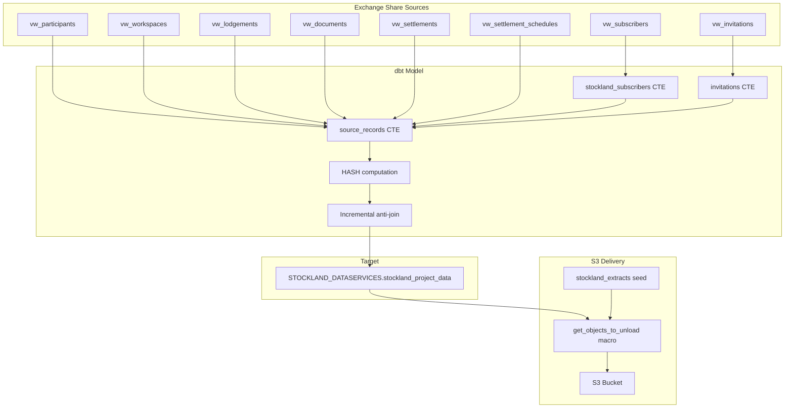

# Design Document: Stockland Bespoke Report

## Overview

This design describes the implementation of a new Stockland bespoke report in the PEXA dbt project. The report is materialised as an incremental Snowflake table using SCD1 merge strategy with hash-based change detection. It joins multiple Exchange Share views to produce a workspace-level report of settlement, invitation, and financial data for Stockland-related participants.

The model follows the established `cj_statuses.sql` SCD1 pattern: compute a HASH over business columns, left-join source vs target on composite key + hash, and merge only new/changed rows.

## Architecture



### Data Flow

1. **Source CTEs** extract and filter data from Exchange Share views
2. **Hash computation** over all fields except `inserted_at` and `updated_at`
3. **Incremental anti-join** compares source hash against target table to identify new/changed rows
4. **dbt merge** upserts rows using the composite key, preserving `inserted_at` and setting `updated_at`
5. **S3 unload** exports the table via the standard bespoke pipeline using seed config

## Components and Interfaces

### 1. SQL Model: `stockland_project_data.sql`

Location: `models/external_data_services/bespoke_reporting/stockland/stockland_project_data.sql`

**Materialization config:**
```sql
{{
  config(
    materialized = 'incremental',
    unique_key = ['workspace_id', 'subscriber_reference', 'lodgement_status', 'ip_subscriber_id', 'im_subscriber_id', 'pexa_project_id'],
    incremental_strategy = 'merge',
    merge_exclude_columns = ['inserted_at', 'updated_at']
  )
}}
```

**CTE Structure:**

| CTE | Purpose |
|-----|---------|
| `stockland_subscribers` | Identifies Stockland subscriber IDs by name prefix `'STOCKLAND '` or explicit ID list |
| `invitations` | Deduplicates invitations per workspace + recipient using `ROW_NUMBER()` |
| `source_records` | Main query joining all sources, computing derived columns, applying DISTINCT |
| Final SELECT | Adds HASH, audit columns, and incremental anti-join logic |

### 2. Schema Routing in `dbt_project.yml`

Add under `external_data_services.bespoke_reporting`:
```yaml
stockland:
  +schema: "STOCKLAND_DATASERVICES"
```

This overrides the default materialization from `view` to the model's own `incremental` config.

### 3. Model Documentation: `stockland_model.yml`

Location: `models/external_data_services/bespoke_reporting/stockland/stockland_model.yml`

Follows the same structure as `anz_model.yml` with model description and column-level descriptions.

### 4. Seed Config: `seeds/bespoke/stockland_extracts.csv`

Drives the S3 unload macro. Single row for the `stockland_project_data` table.

### 5. dbt_project.yml Seed Config

Already inherited from the existing `bespoke` seed block:
```yaml
bespoke:
  +database: "{{env_var('DBT_GROUP_EXT_DATASERVICES_DB')}}"
  +schema: "OUTBOUND_SEEDS"
```

## Data Models

### Output Columns

| Column | Type | Description |
|--------|------|-------------|
| `workspace_id` | NUMBER | PEXA workspace identifier |
| `subscriber_reference` | VARCHAR | Participant's subscriber reference for the workspace |
| `workspace_status` | VARCHAR | Current status of the workspace |
| `lodgement_status` | VARCHAR | Status of the lodgement (CLOSED, LODGED, etc.) |
| `financial_settlement_status` | VARCHAR | Settlement financial status |
| `settlement_date` | DATE | Scheduled or actual settlement date |
| `settlement_time_aest` | VARCHAR | Settlement time in AEST timezone |
| `settlement_booking_status` | VARCHAR | Composite status derived from IP/IM/POT statuses and settlement date presence |
| `ip_subscriber_id` | NUMBER | Incoming Proprietor subscriber ID |
| `ip_invitation_status` | VARCHAR | Invitation status for the Incoming Proprietor |
| `ip_settlement_booking_status` | VARCHAR | Settlement booking status for IP participant |
| `im_subscriber_id` | NUMBER | Incoming Mortgagee subscriber ID |
| `im_invitation_status` | VARCHAR | Invitation status for the Incoming Mortgagee |
| `im_settlement_booking_status` | VARCHAR | Settlement booking status for IM participant |
| `vendor_funds` | NUMBER(38,2) | Sum of settlement schedule amounts (category 7) divided by 100 |
| `pot_settlement_booking_status` | VARCHAR | Settlement booking status for POT (Purchaser On Title) |
| `pexa_project_id` | VARCHAR | PEXA project identifier |
| `hash` | NUMBER | HASH over all business columns for change detection |
| `inserted_at` | TIMESTAMP_TZ | Row first-insert timestamp (AEST) |
| `updated_at` | TIMESTAMP_TZ | Row last-updated timestamp (AEST) |

### Composite Key

```
['workspace_id', 'subscriber_reference', 'lodgement_status', 'ip_subscriber_id', 'im_subscriber_id', 'pexa_project_id']
```

### Hash Column

The hash is computed over all output fields **except** `inserted_at` and `updated_at`. This means it includes every business column plus any other non-audit columns:

```sql
HASH(
    workspace_id, subscriber_reference, workspace_status, lodgement_status,
    financial_settlement_status, settlement_date, settlement_time_aest,
    settlement_booking_status, ip_subscriber_id, ip_invitation_status,
    ip_settlement_booking_status, im_subscriber_id, im_invitation_status,
    im_settlement_booking_status, vendor_funds, pot_settlement_booking_status,
    pexa_project_id
) AS hash
```

Note: The hash excludes only `inserted_at` and `updated_at` (the audit/timestamp columns). All other columns in the SELECT are included in the hash computation.

### SQL Structure (Pseudocode)

```sql
{{
  config(
    materialized = 'incremental',
    unique_key = ['workspace_id', 'subscriber_reference', 'lodgement_status', 'ip_subscriber_id', 'im_subscriber_id', 'pexa_project_id'],
    incremental_strategy = 'merge',
    merge_exclude_columns = ['inserted_at', 'updated_at']
  )
}}

WITH stockland_subscribers AS (
    -- Filter subscribers: name LIKE 'STOCKLAND %' OR id IN (1412651, 1700340, ...)
    SELECT subscriber_id
    FROM {{ source('exchange_share', 'vw_subscribers') }}
    WHERE name LIKE 'STOCKLAND %'
       OR subscriber_id IN (1412651, 1700340, 1730940, 2218092, 2591412, 3018996)
),

invitations AS (
    -- Deduplicate: most recent invitation per workspace + recipient
    SELECT *
    FROM (
        SELECT
            workspace_id,
            to_subscriber_id,
            status AS invitation_status,
            ROW_NUMBER() OVER (
                PARTITION BY workspace_id, to_subscriber_id
                ORDER BY invitation_id DESC
            ) AS counter
        FROM {{ source('exchange_share', 'vw_invitations') }}
    )
    WHERE counter = 1
),

source_records AS (
    SELECT DISTINCT
        w.workspace_id,
        p.reference AS subscriber_reference,
        w.status AS workspace_status,
        l.status AS lodgement_status,
        s.status AS financial_settlement_status,
        s.date1 AS settlement_date,
        -- settlement_time_aest derivation
        -- settlement_booking_status composite CASE logic
        ip.subscriber_id AS ip_subscriber_id,
        ip_inv.invitation_status AS ip_invitation_status,
        -- ip_settlement_booking_status
        im.subscriber_id AS im_subscriber_id,
        im_inv.invitation_status AS im_invitation_status,
        -- im_settlement_booking_status
        -- vendor_funds = SUM(ss.amount)/100 WHERE settlement_category_id = 7
        -- pot_settlement_booking_status
        w.pexa_project_id
    FROM {{ source('exchange_share', 'vw_workspaces') }} w
    INNER JOIN {{ source('exchange_share', 'vw_participants') }} p
        ON w.workspace_id = p.workspace_id
    INNER JOIN stockland_subscribers ss_filter
        ON p.subscriber_id = ss_filter.subscriber_id
    -- Additional joins for lodgements, documents, settlements, schedules, invitations
    WHERE (l.transaction_type IN ('WCTM','DT','WCT','T','WCDT','TM','DTM','WCDTM') OR l.transaction_type IS NULL)
)

SELECT
    s.workspace_id,
    s.subscriber_reference,
    s.workspace_status,
    s.lodgement_status,
    s.financial_settlement_status,
    s.settlement_date,
    s.settlement_time_aest,
    s.settlement_booking_status,
    s.ip_subscriber_id,
    s.ip_invitation_status,
    s.ip_settlement_booking_status,
    s.im_subscriber_id,
    s.im_invitation_status,
    s.im_settlement_booking_status,
    s.vendor_funds,
    s.pot_settlement_booking_status,
    s.pexa_project_id,
    HASH(
        s.workspace_id, s.subscriber_reference, s.workspace_status, s.lodgement_status,
        s.financial_settlement_status, s.settlement_date, s.settlement_time_aest,
        s.settlement_booking_status, s.ip_subscriber_id, s.ip_invitation_status,
        s.ip_settlement_booking_status, s.im_subscriber_id, s.im_invitation_status,
        s.im_settlement_booking_status, s.vendor_funds, s.pot_settlement_booking_status,
        s.pexa_project_id
    ) AS hash,
    {{ var('inserted_at') }} AS inserted_at,
    {{ var('updated_at') }} AS updated_at
FROM source_records s

LEFT JOIN {{ this }} t
    ON  s.workspace_id = t.workspace_id
    AND s.subscriber_reference = t.subscriber_reference
    AND s.lodgement_status = t.lodgement_status
    AND s.ip_subscriber_id = t.ip_subscriber_id
    AND s.im_subscriber_id = t.im_subscriber_id
    AND s.pexa_project_id = t.pexa_project_id
    AND HASH(...) = t.hash
WHERE t.workspace_id IS NULL

```

### Seed CSV Structure

`seeds/bespoke/stockland_extracts.csv`:

```csv
table_name,incremental_timestamp_column,path_prefix,path_date_format,file_datetime_format,need_file_ext,file_ext,output_path_format,unload_single_file
stockland_project_data,,stockland_project_data,%Y-%m-%d,%Y%m%d,true,.csv,/%(au_path_date)s/stockland_project_data_%(au_file_date)s%(ext)s,true
```

### dbt_project.yml Changes

Under `models.pexa_one_data_au_group_dbt.external_data_services.bespoke_reporting`:

```yaml
stockland:
  +schema: "STOCKLAND_DATASERVICES"
```

This sits alongside the existing `westpac`, `cba`, `anz`, and `nab` entries.


## Correctness Properties

*A property is a characteristic or behavior that should hold true across all valid executions of a system — essentially, a formal statement about what the system should do. Properties serve as the bridge between human-readable specifications and machine-verifiable correctness guarantees.*

### Property 1: Hash sensitivity to column changes

*For any* two source records that differ in at least one field (excluding `inserted_at` and `updated_at`), the computed HASH values should be different. The hash is computed over all output columns except the audit timestamps.

**Validates: Requirements 2.4, 4.1**

### Property 2: Incremental anti-join correctness

*For any* source record and target table state, a source row should appear in the incremental merge output if and only if no row exists in the target with both the same composite key (workspace_id, subscriber_reference, lodgement_status, ip_subscriber_id, im_subscriber_id, pexa_project_id) AND the same hash value.

**Validates: Requirements 2.5, 4.2, 4.3**

### Property 3: Audit column invariants

*For any* row that already exists in the target table, after a merge operation the `inserted_at` value should remain unchanged from its original value. For any row in the output of an incremental run (whether new or changed), `updated_at` should be set to the current execution timestamp.

**Validates: Requirements 2.6, 2.7**

### Property 4: Subscriber filter correctness

*For any* subscriber, they should be included in the Stockland report if and only if their name starts with 'STOCKLAND ' (with trailing space) OR their subscriber_id is in the set {1412651, 1700340, 1730940, 2218092, 2591412, 3018996}. No other subscribers should appear in the output.

**Validates: Requirements 3.1**

### Property 5: Settlement booking status derivation

*For any* combination of IP settlement booking status, IM settlement booking status, POT settlement booking status, and settlement date presence/absence, the derived `settlement_booking_status` value should be deterministic and follow the defined composite CASE logic consistently.

**Validates: Requirements 3.4**

### Property 6: Vendor funds calculation

*For any* workspace with settlement schedule records, the `vendor_funds` value should equal the sum of all `amount` values where `settlement_category_id = 7`, divided by 100. If no category-7 records exist for a workspace, vendor_funds should be NULL or 0.

**Validates: Requirements 3.5**

### Property 7: Transaction type filter

*For any* row in the report output, the originating lodgement's `transaction_type` must be one of ('WCTM', 'DT', 'WCT', 'T', 'WCDT', 'TM', 'DTM', 'WCDTM') or NULL. No other transaction type values should be present in the output.

**Validates: Requirements 3.6**

### Property 8: No duplicate rows

*For any* output of the report (whether full refresh or incremental), there should be no two rows with identical values across all business columns.

**Validates: Requirements 3.7**

### Property 9: Invitation deduplication

*For any* workspace and recipient subscriber pair that has multiple invitations, only the invitation with the highest `invitation_id` should be reflected in the report output. Earlier invitations for the same workspace + subscriber should be excluded.

**Validates: Requirements 3.8**

### Property 10: Full refresh completeness

*For any* full refresh run, the output should contain every source record that passes the subscriber filter and transaction type filter — no change-detection join should be applied.

**Validates: Requirements 4.4**

## Error Handling

| Scenario | Handling |
|----------|----------|
| NULL composite key columns | Rows with NULL in any composite key column will not merge correctly — the SQL uses equality joins which exclude NULLs. These rows will be re-inserted on every run. Mitigation: COALESCE key columns to sentinel values (e.g., -1 for IDs, 'UNKNOWN' for strings) in the source CTE. |
| Source view unavailable | dbt will fail at compile/run time with a source not found error. No special handling needed — standard dbt behavior. |
| Hash collisions | Snowflake's HASH function has extremely low collision probability for distinct inputs. No mitigation needed for practical data volumes. |
| Empty source results | On full refresh with no matching data, an empty table is created. On incremental with no new/changed rows, no merge is executed. Both are safe. |
| Division by zero in vendor_funds | Not applicable — we sum amounts and divide by 100 (a constant). If no rows match, SUM returns NULL. |
| NULL handling in HASH | Snowflake's HASH function handles NULLs deterministically — NULL inputs produce consistent hash values. |

## Testing Strategy

### Unit Tests

Unit tests validate specific examples and edge cases:

- **Subscriber filter edge cases**: Verify that 'STOCKLAND' (no trailing space) is excluded, 'STOCKLAND PROPERTIES' is included, and each explicit ID is included
- **Transaction type filter**: Verify that 'CONSENT' and 'NOMINATION' are excluded, NULL is included, each allowed type is included
- **Invitation deduplication**: Verify that for 3 invitations to the same workspace+subscriber, only the one with highest invitation_id survives
- **Vendor funds calculation**: Verify correct sum/division for a known set of settlement schedules with mixed category IDs
- **Settlement booking status**: Verify each branch of the composite CASE logic with specific input combinations
- **Seed config validation**: Verify that `table_name` in the seed CSV exactly matches the model name

### Property-Based Tests

Property-based tests use the **dbt unit testing framework** combined with **generated test data** to validate universal properties. Since this is a dbt/SQL project, property-based testing is implemented via:

1. **dbt generic tests** for schema-level properties (uniqueness, not-null, accepted values)
2. **dbt unit tests** (YAML-based) for transformation logic with varied inputs
3. **Custom SQL tests** in `tests/` that validate properties across the full dataset

**Configuration:**
- Each property test should be tagged with a comment referencing the design property
- Tag format: `Feature: stockland-bespoke-report, Property {number}: {property_text}`

**Property test implementations:**

| Property | Test Implementation |
|----------|-------------------|
| P1: Hash sensitivity | dbt unit test: provide two rows differing in one column, assert different hash values |
| P2: Anti-join correctness | dbt unit test: mock `{{ this }}` with known rows, verify only changed/new rows appear |
| P3: Audit columns | dbt unit test: mock incremental run with existing rows, verify inserted_at preserved |
| P4: Subscriber filter | Generic test: `accepted_values` on subscriber source + custom SQL test asserting no non-Stockland subscribers |
| P5: Booking status | dbt unit test: generate all combinations of IP/IM/POT statuses × settlement date presence |
| P6: Vendor funds | dbt unit test: provide settlement schedules with known amounts, verify calculation |
| P7: Transaction type filter | Generic test: `accepted_values` on lodgement_status with allowed list + NULL |
| P8: No duplicates | Generic test: `unique` on the composite key |
| P9: Invitation dedup | dbt unit test: provide multiple invitations per workspace+subscriber, verify only latest used |
| P10: Full refresh | dbt unit test: run without `is_incremental()`, verify all source rows present |

### dbt Generic Tests (in `stockland_model.yml`)

```yaml
- name: stockland_project_data
  tests:
    - unique:
        column_name: "workspace_id || subscriber_reference || lodgement_status || ip_subscriber_id || im_subscriber_id || pexa_project_id"
  columns:
    - name: workspace_id
      tests:
        - not_null
    - name: subscriber_reference
      tests:
        - not_null
    - name: hash
      tests:
        - not_null
```
